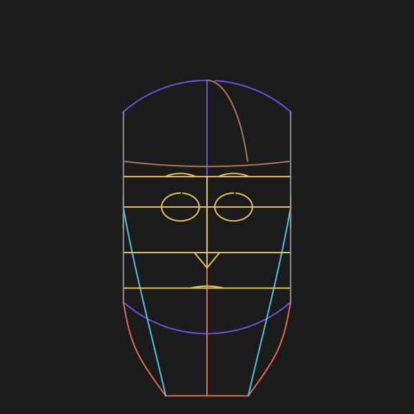
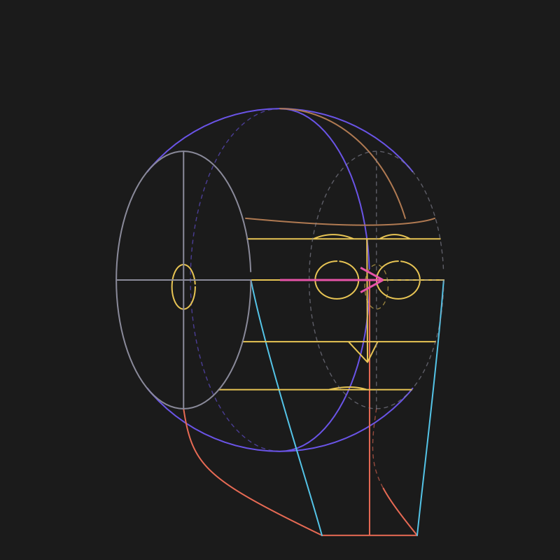
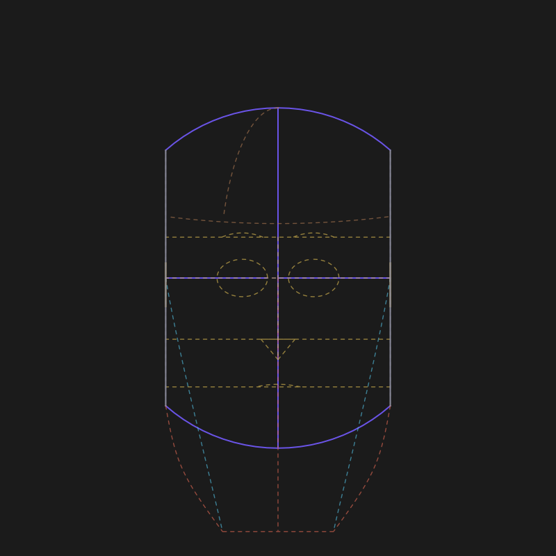
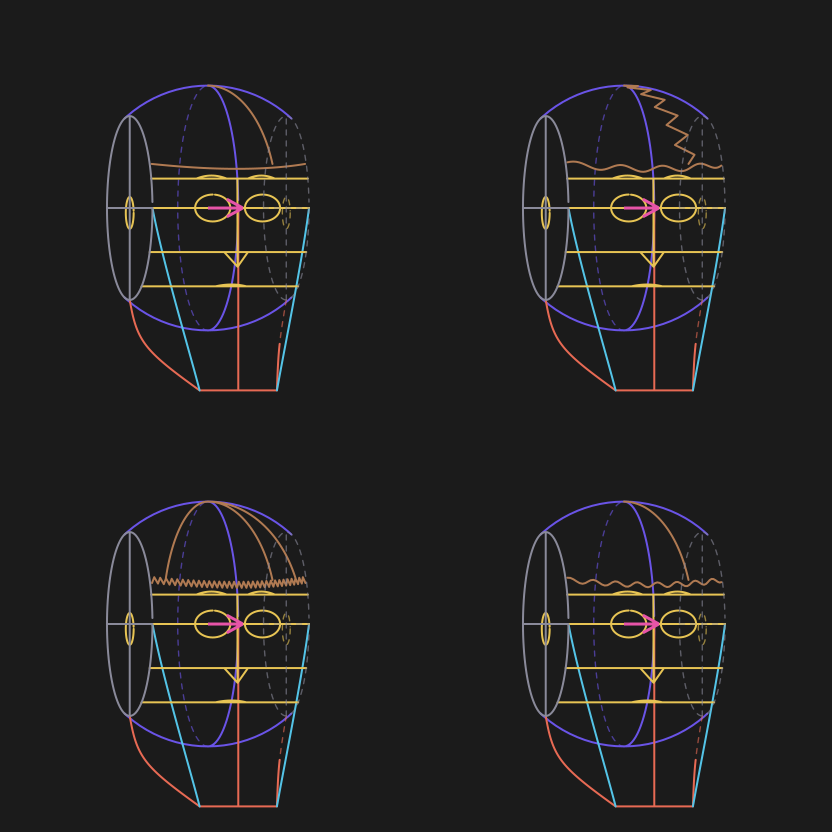
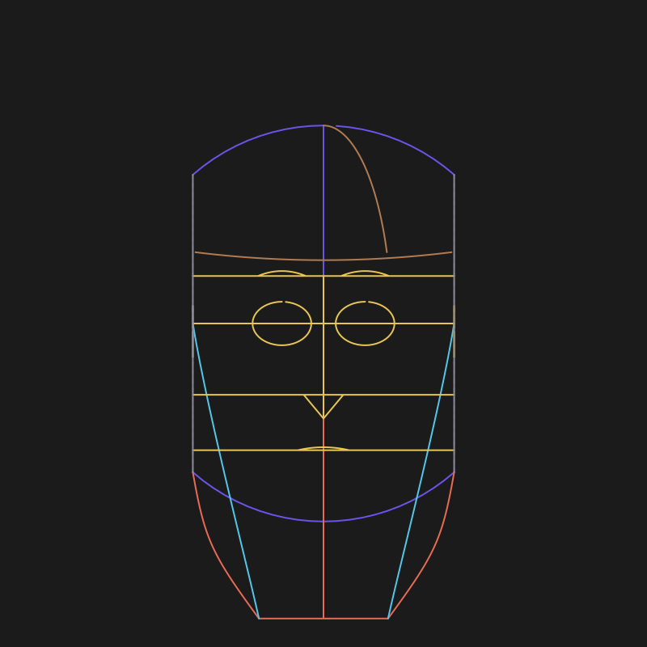
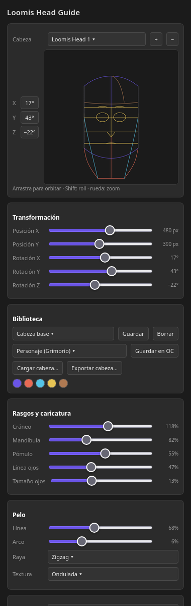

# Loomis Head Guide for Krita

A free, local **Loomis-method head construction guide** for Krita: rotate a 3D head,
customize the skull, face features, hair and caricature, save per-character presets and
share head files with other artists.

This is a fork of [Nedeljko Umjetnik's Loomis Method Head Guide](https://nedeljko-umjetnik.itch.io/loomis-method-head-guide-plugin-for-krita),
which is based on [lm0ss's Loomis Head Generator](https://github.com/lm0ss/loomis-head-krita).
The improvements in this fork are by **imboolean** (see [CREDITS.md](CREDITS.md)).



| Front | 3/4 | Back |
| --- | --- | --- |
|  |  |  |

| Hair patterns | Zone colours |
| --- | --- |
|  |  |



> The head images and GIF are real renders produced by the plugin's generator. The panel
> image is an HTML mockup of the docker layout (a real Krita screenshot would be even
> better; contributions welcome). The HTML source is in
> [`docs/media/panel-preview.html`](docs/media/panel-preview.html).

## Features

- **Tabbed docker**: the head, 3D preview, view selector, library and action buttons stay
  fixed; Settings, Move, Guides, Features and Hair live in scrollable tabs.
- **Two head models**: a **Model** combo switches between the **Loomis** construction and a
  low-poly **Asaro** planar bust (face contours with planes, edges, detail level and a
  neck). Each model keeps its own state, so switching back and forth does not lose features
  or hair, and the shared position, rotation, scale and stroke follow the guide. As of 0.7.4
  the Asaro mesh is a hand retopology over the real bust — 122 / 242 / 272 faces at
  detail 0 / 1 / 2, mouth band, ear with concha and plane banding, neck and base included —
  with the **Show neck** and **Shade planes** toggles. It is still a faceted low-poly
  reference, not a smooth anatomical sculpt (licensed **CC BY 4.0** with attribution, see
  [LICENSE-ASSETS.md](LICENSE-ASSETS.md)). It is a **work in progress**: profile, cranium
  vault and ear are still low-poly and the Asaro panel is minimal. See
  [release/RELEASE-NOTES-0.7.12.md](release/RELEASE-NOTES-0.7.12.md).
- **Real 3D preview**: drag to orbit freely (arcball), `Shift`/right-drag to roll, wheel to
  zoom, double-click to reset. View shortcuts for front, 3/4, profile, back and top.
- **Pivot and redraw (0.7.4, delay in 0.7.5, Move in 0.7.8, review fixes in 0.7.9,
  base/delta in 0.7.10)**: the head rotates around an invisible pivot at the centre of the
  skull, so rotating or switching model/type/sex keeps it in place. `addShapesFromSvg`
  leaves the layer's **base** scale in `Shape.transformation()` (0.24 on a 300 ppi canvas)
  and Krita writes a manual Move/Transform on top of it, so the docker keeps the two apart:
  the **base** is captured right after the SVG import (per layer, never persisted) and the
  **delta** is the user's Move (`current ∘ base⁻¹`), saved in `guides.json` (`transform` +
  `"transformIsDelta": true`) and in the head state (`layerTransform`), so it survives
  redraws, document reloads and presets. A redraw applies **delta ∘ base once**; with the
  delta at identity `setTransformation()` is not called at all. 0.7.9 captured the base as
  if it were the Move and reapplied it, squaring the scale (0.24² = 0.0576) and leaving the
  head invisible: 0.7.8/0.7.9 absolute values are migrated to a delta on load
  (`delta = stored ∘ base⁻¹`) and re-saved with the flag, so they are never migrated twice.
  The pivot is synced **before** every redraw, so touching the docker no longer sends the
  head back to its old X/Y; an explicit reset returns the shapes to the base, not to
  identity. The docker preview is live while you drag, and the vector layer redraws after
  you stop; the **Delay** spinbox under View sets that wait (50–5000 ms, 500 by default).
  Each sync with a new matrix and each draw are logged to `loomis_head/pivot.log` in
  Krita's app data directory, with `base=` / `delta=` / `reapplied=` fields (see
  [docs/ARCHITECTURE.md](docs/ARCHITECTURE.md)).
  The docker **X/Y is the effective position in document pixels**: the model pivot passed
  through `delta ∘ base` and divided by the base scale (`(delta·base·p) / base`), because
  shape transformations live in layer units (points), not pixels. Editing X/Y undoes the
  base, solves the inverse (`M_lin⁻¹·(target/base − t)`) and moves only the model pivot, so
  the Move is kept and the head does not jump even when the layer is rotated or scaled.
- **Individual axes**: X/Y/Z rotation sliders and spinboxes; moving one axis does not
  touch the others.
- **Loomis construction**: sphere, side cut, jaw, chin, cheekbones, brow/eye/nose/mouth
  lines, eye sockets, brows, nose, ears and mouth. Brow, eye, nose and mouth guide lines
  can be shown or hidden independently.
- **Head sex and structure**: male/female presets that combine with the head style; a
  sunken orbital socket (rim, inner floor and depth ticks), a superciliary brow ridge and a
  cheek-fill curve make the skull read in 3D.
- **Parametric proportions**: forehead height, jaw angle, cranium width/height, cheekbone
  height and chin sharpness, plus caricature and head-type presets.
- **Reilly rhythm curves**: optional crown→brow→nose→mouth→chin flow lines and lateral
  arches, with adjustable strength.
- **Caricature and head types**: realistic, semi, anime, chibi and caricature presets;
  cranium, jaw, cheek, face width and jaw drop are adjustable.
- **Custom hair**: hairline, arch, tilt, part position, part pattern (straight, zigzag,
  spiky) and texture (smooth, wavy, spiky, curly).
- **Zone colours**: cranium, jaw, cheek, features, hair and side guides use different
  colours so each part reads at a glance.
- **Several independent heads per document**: one vector layer (`Loomis Head N`) per
  head, a head selector, add/delete, and automatic selection of its layer in Krita.
- **Per-document state**: position, rotation, scale, features and hair are saved in
  `guides.json` and restored after restart for saved `.kra` files.
- **Presets**: named presets and presets linked to a Grimoire of Color character.
- **Shareable heads**: load/export a head as JSON (`format`, `model`, `name`, `author`,
  `license`, `tags`, `head`). See [`heads/`](heads/README.md).
- **Languages**: English, Spanish, Portuguese and French with a language selector in the
  panel; the choice is remembered.
- **Qt5/Qt6 ready**: all Qt imports go through `qt_compat.py`, which also maps the enums
  PyQt6 removed. Tested on PyQt5 (Krita 5.3.4.1); PyQt6 is implemented but not tested on a
  real Krita 6.
- **Standalone or integrated**: works on its own; if
  [Grimoire of Color](https://github.com/ImBoolean-2/color-grimoire) is installed it can
  also save the head into the active OC.

## Install

### ZIP (recommended)

1. Download `release/loomis-head-guide-0.7.12.zip` (last public build; 0.7.3 to 0.7.11
   were local-only).
2. In Krita: **Tools → Scripts → Import Python Plugins** and choose the ZIP.
3. Restart Krita and open **Settings → Configure Krita → Python Plugin Manager**; enable
   **Loomis Method Head Guide**.

### Manual

Copy `loomis_head/` and `loomis_head.desktop` into Krita's `pykrita` directory, restart
Krita and open **Settings → Dockers → Loomis Head Guide**.

Linux Flatpak example:

```bash
cp -r loomis_head loomis_head.desktop \
  ~/.var/app/org.kde.krita/data/krita/pykrita/
```

Tested with Krita **5.3.4.1** (Flatpak, PyQt5). The plugin imports Qt through
`qt_compat.py` and is prepared for **Krita 6 / PyQt6**, but that combination has only been
simulated, not run on a real Krita 6.

## Undo

Krita 5.3.4's Python API does not expose `beginUndo`/`endUndo` or `KUndo2Command`, so the
plugin cannot group a redraw into one undo step. As a mitigation the vector layer redraws
only after the **Delay** set in the panel (500 ms by default, no flush when a slider is
released), which keeps a drag to a few undo entries instead of dozens. A real single-step
undo needs C++ and is tracked as debt.

## Languages

The panel has a **Language** selector (`Auto`, English, Español, Português, Français)
and remembers the choice in `settings.json`. `LOOMIS_LANG=es|en|pt|fr` still works as an
override. Translations are plain JSON files in `loomis_head/translations/`; adding a
language is a JSON file plus one entry in `SUPPORTED` in `i18n.py`.

## Standalone and with Grimoire of Color

- **Standalone**: presets (`presets.json`), head state (`guides.json`), settings
  (`settings.json`) and head JSON files live in Krita's app data directory. Nothing from
  the Grimoire is required. The OC row is disabled with a "Grimoire not detected" message.
  `guides.json` keeps the manual Move (`transform`) and the head state keeps
  `layerTransform`, so a reopened document restores the position you left.
- **Together**: if `grimorio.json` exists, the panel lists its characters; saving to an OC
  writes only the character's `head` block (with a `grimorio.json.loomis.bak` backup) and
  also keeps the sidecar preset. The Grimoire treats `head` as an opaque block, so it
  travels in Export/Import and the web app shows a small summary.

Data paths (Flatpak example):

```text
~/.var/app/org.kde.krita/data/loomis_head/
├── presets.json    named presets + per-OC presets
├── guides.json     per-document head state (position, rotation, parameters, transform)
└── settings.json   language
```

## Share a head

Use **Export head…** in the Library section. The JSON looks like:

```json
{
  "format": "loomis-head",
  "version": 1,
  "model": "loomis",
  "name": "Loomis base",
  "author": "your-name",
  "license": "CC0-1.0",
  "tags": ["loomis", "base"],
  "head": { "scale": 0.42, "rotation": [1, 0, 0, 0] }
}
```

Put a JSON and a 400×400 preview PNG in `heads/<author>/` (see
[`heads/README.md`](heads/README.md)). `model` is `loomis` or `asaro`; the loader resolves
it through the model registry and refuses an unknown model with a message. An Asaro head
uses the same wrapper with `"model": "asaro"` (see `heads/example-asaro.json`).

## Asaro head

> **Work in progress.** The Asaro model is a plane study, **not** a proportion reference.
> Its design and configuration are still poor: the profile, the cranium vault and the ear
> are low-poly and do not hold up in a demanding side view, the plane transitions are
> coarse at detail 0, and the Asaro panel offers only planes, edges, shading and detail
> (no fine control of planes or proportions). Use it as a block-in aid for planes; Loomis
> is the main engine and the one that gets the fine adjustments.

The second model is a low-poly study of the **Asaro head** (the planar head used to learn
the planes of the face). It is drawn as face contours, not as a shaded sculpt:

- **Clean retopology (0.7.4)**: since 0.7.4 it is a hand retopology over the silhouette of
  the real **Asaro_high** bust, kept as static data in `loomis_head/asaro_clean_mesh.py` —
  no OBJ at runtime. Rows are flow lines (the mouth line dips in the centre, the brow arches
  over the socket), the mouth is a three-row band, the ear has a hollow concha and the
  temple, cheekbone, orbital and mastoid planes are banded in; the mesh is closed. The
  0.7.3 decimation stays in `asaro_mesh.py` as a reference for tests and comparisons.
- **Detail levels** (head + neck and base, 0.7.4): **122 faces** at detail 0, **242** at
  detail 1 (193 head) and **272** at detail 2 (217 head), with 131 / 257 / 289 vertices.
- **Invisible pivot**: the head rotates around the centre of the skull (for Asaro, the area
  centroid of the head faces, `(0.0, 0.2852, -0.0354)` in mesh coordinates; for Loomis, the
  sphere centre). `position_x/y` is the pivot, so rotating or switching model/type/sex does
  not move the head. An invisible `loomis-pivot` marker in the layer tracks manual canvas
  moves: the Move/Transform is captured from the shapes' `transformation()`, kept in
  `guides.json` (`transform`) and used to show the effective X/Y (`M·p + t`).
- **Neck**: **Show neck** in the Asaro panel (`showNeck` in JSON, on by default). With it
  off the neck and base faces are hidden and the cut is capped, so the head stays a closed
  solid.
- **Shade planes**: **Shade planes** (`shadePlanes`, on by default) fills every face with
  a neutral tone picked from its orientation — it is a plane reading, not a directional
  light; opacity 0.18–0.28.
- **Controls**: planes, edges, shade and detail (0 coarse, 1 standard, 2 fine).
- **References**: retopologised derivative of the Sketchfab model **Asaro-head** by
  **ivan4akir** (CC BY 4.0), a scan of the plane head designed by **John Asaro**;
  `heads/example-asaro.json` is the shareable sample.

It is deliberately a **faceted reference**: it is a plane study, not a smooth sculpt, and
every silhouette is a chain of segments. Use it to place planes, then draw over it.

> **License of the mesh.** The mesh data is **CC BY 4.0**, not GPL: it is a decimated and
> retopologised derivative of "Asaro-head" by **ivan4akir** (CC BY 4.0), whose design is by
> **John Asaro**. Keep the attribution and the modification notice if you redistribute it;
> the full text and a copy-paste credit line are in
> [LICENSE-ASSETS.md](LICENSE-ASSETS.md). The plugin code itself stays GPL-3.0-only. The
> current public build is **0.7.12** (`release/loomis-head-guide-0.7.12.zip` plus the
> cumulative patch); its release notes are in
> [release/RELEASE-NOTES-0.7.12.md](release/RELEASE-NOTES-0.7.12.md).

## Development

```bash
cd loomis_head
python3 -m unittest test_generator test_asaro -v
```

The **153** unit tests (76 generator + 77 Asaro) do not need Krita, Qt or PyQt5. The
docker acceptance test needs Qt but **not** Krita: it builds `LoomisProportionsDocker`
with a `krita` stub and no document (five tabs, Delay 50–5000 ms at 500, model panels and
`_visible_position()`). It skips with `unittest.SkipTest` when no PyQt5/PyQt6 is available,
so the plain suite stays green on a host without Qt:

```bash
# host: SKIP unless PyQt5 is installed
python3 loomis_head/test_ui_offscreen.py

# Krita's flatpak (PyQt5): real offscreen run
flatpak run --env=QT_QPA_PLATFORM=offscreen --env=QT_QPA_PLATFORMTHEME= \
  --command=python3 --filesystem=home --filesystem=/tmp org.kde.krita \
  loomis_head/test_ui_offscreen.py
```

The UI checks of 0.6.x to 0.7.8 were **ad hoc scripts run inside Krita's flatpak**
(`test_dashboard_070.py`, `test_draw_sync.py`, `test_build_078.py`, `check_neck_ui.py`,
`check_shade_planes_ui.py`, `check_pivot_marker.py`); they were never added to the repo and
cannot be re-run by anyone else, so only `test_ui_offscreen.py` remains as a reproducible
check. Real canvas behaviour (a manual Move, saving and reopening a `.kra`) still has to be
verified by hand in Krita.

Repository layout:

```text
loomis_head/            plugin source (the ZIP root is this folder + .desktop)
loomis_head.desktop
heads/                  shareable head presets and format
docs/media/             GIF and screenshots
docs/ARCHITECTURE.md    code map and state files
release/                installable ZIP
```

## Contributing

Contributions are welcome: languages, hair patterns, head presets, features and fixes.
Please read [CONTRIBUTING.md](CONTRIBUTING.md) before opening a PR. Code contributions are
accepted under **GPL-3.0-only**; do not paste third-party mesh data that is not
CC BY 4.0-compatible (see [LICENSE-ASSETS.md](LICENSE-ASSETS.md)).

## Credits and license

- Original **Loomis Head Generator**: lm0ss (2025), GPL-3.0.
- **Loomis Method Head Guide**: Nedeljko Umjetnik (2026).
- This fork and improvements: **imboolean** (2026).
- **Asaro head mesh**: design by **John Asaro**; derivative of **Asaro-head** by
  **ivan4akir** (CC BY 4.0); "Simple Asaro Head" by **fabianoaraujo** (CC BY 4.0) reviewed
  and not used.

See [CREDITS.md](CREDITS.md) for the full lineage. Two licenses apply:

- **Code**: GPL-3.0-only; `euclid.py` is LGPL-2.1 (see [LICENSE](LICENSE)).
- **Asaro mesh assets**: **CC BY 4.0** with attribution and a modification notice, not
  relicensed as GPL (see [LICENSE-ASSETS.md](LICENSE-ASSETS.md)).

The plugin works offline: no telemetry, no network, no accounts.
