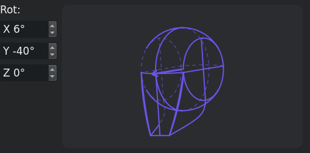
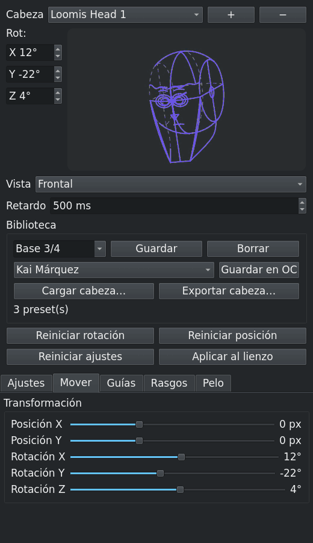
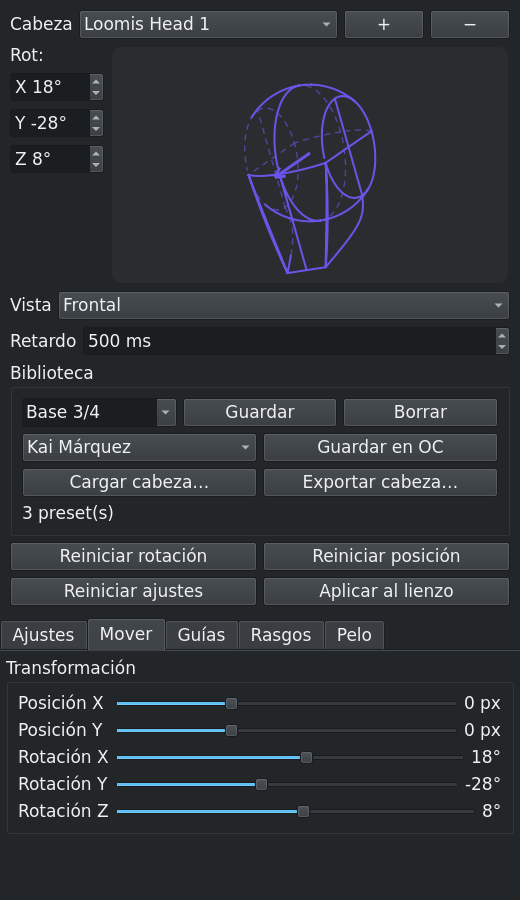
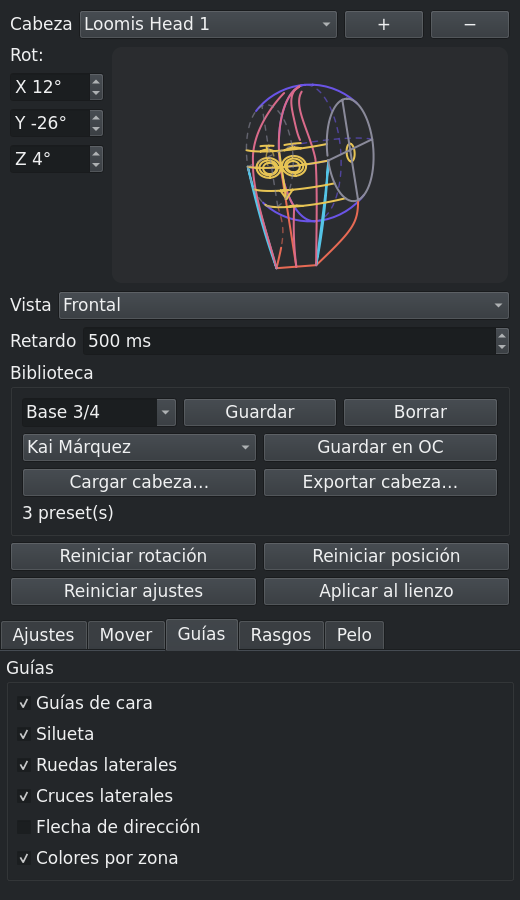
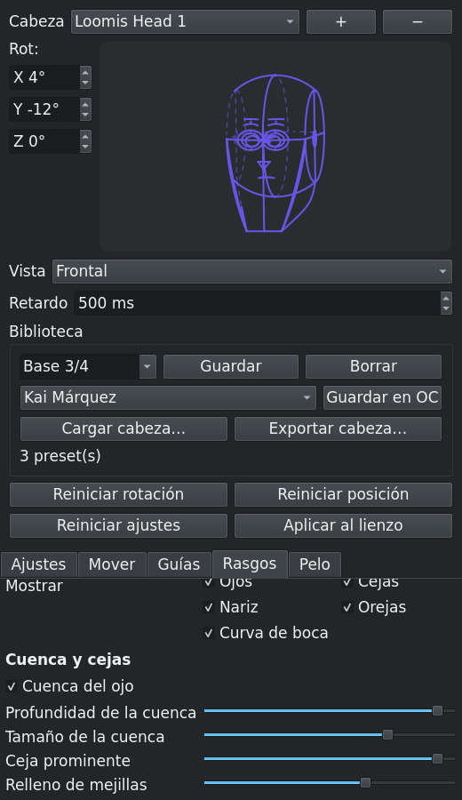
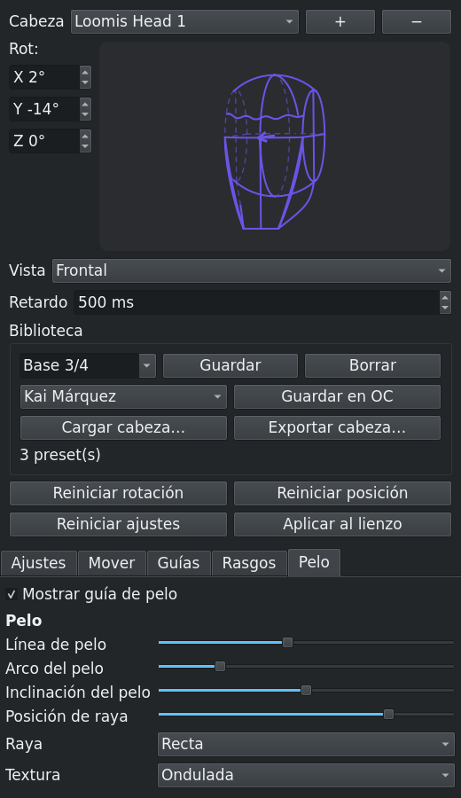
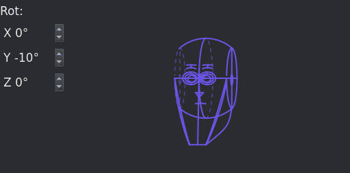

**Download v0.7.13:** https://github.com/ImBoolean-2/loomis-head-guide/releases/tag/v0.7.13

Hi everyone,

v0.7.13 of **Loomis Head Guide** is out. It is the free, offline head-construction plugin
for Krita that I forked from Nedeljko Umjetnik's guide (itself based on lm0ss's Loomis Head
Generator). There were ten internal builds since the first public v0.5.0 (0.7.3 to 0.7.12), and this
one brings the fixes that mattered most in daily use.

## What changed since v0.5.0

- **Heads are no longer drawn clipped.** This was the worst one: rotating or moving a head
  sometimes left half of it on the canvas, or nothing at all, until you closed and reopened
  the `.kra`. The SVG was fine — Krita caches a vector layer and only invalidates the
  rectangle each shape reports, so the new geometry that fell outside that rectangle never
  reached the canvas or the saved file. The plugin now resets the layer cache and refreshes
  the projection after rebuilding the SVG. I confirmed it on a saved `.kra`: its
  `content.svg` had the full head (x 1008–1279 px) while its `mergedimage.png` was cut at
  x 1178.
- **Move/Transform now survives every redraw.** Before, moving the layer with Krita's Move
  tool was undone the next time you touched a slider. The fix separates the **base** scale
  that Krita's SVG importer applies to the shapes (72/300 = 0.24 at 300 ppi) from the
  **delta** of your Move, and reapplies the delta once on top of the base. Mixing them up
  reapplied the scale itself and left the head at 0.24² ≈ 0.06 — invisible.
- **The Asaro head uses the real mesh.** The hand-drawn mesh was replaced by a hand
  retopology over the real `Asaro_high` bust: **122 / 242 / 272 faces** at detail 0 / 1 / 2,
  with flow lines that follow the planes, a mouth band, a hollow concha and the neck/base.
  The old decimation stays in the source as a test reference.
- **Works with Grimoire of Color 0.7.0, and without it.** The plugin writes only
  `characters[].head` in `grimorio.json` and leaves the rest untouched. Two details were
  fixed in 0.7.12: the file keeps its `0600` mode (it stores `privateMode`), and the `head`
  block is **merged** instead of replaced, so legacy keys (the old light settings) or keys
  from a future version are not lost. Without Grimoire the plugin runs in independent mode
  and saves presets in its own directory.
- **The Features tab fits the docker width again** (0.7.13). The "Show" row of five
  checkboxes requested ~690 px while the docker is ~520 px wide and the scroll area has no
  horizontal bar, so the last controls were cut off. They now flow in a two-column grid.
- **Smaller things:** 500 ms redraw delay (adjustable 50–5000) so dragging a slider does not
  flood the undo history; the 3D preview keeps its own live update; one vector layer per
  head; per-document state; named presets and shareable head JSON; English, Spanish,
  Portuguese and French.

## The panels

| | |
|---|---|
|  |  |
|  |  |

## Asaro is still a work in progress

The Asaro model is a **plane study, not a proportion reference**: the profile, the cranium
vault and the ear are still low-poly and do not hold up in a demanding side view, the plane
transitions are coarse at detail 0, and its panel only offers planes, edges, shading and
detail — no fine control of planes or proportions. Use it to block in planes; Loomis is the
main engine and the one that gets the fine adjustments. The mesh is a modified derivative
(decimation + retopology) of the **Asaro-head** scan by **ivan4akir** (CC BY 4.0), designed
by **John Asaro**, and is not relicensed under the GPL.

## Install

1. Download the ZIP from the release: https://github.com/ImBoolean-2/loomis-head-guide/releases/tag/v0.7.13
2. In Krita: **Tools → Scripts → Import Python Plugins** and choose the ZIP.
3. Restart Krita and enable it in **Settings → Configure Krita → Python Plugin Manager**.
4. Open **Settings → Dockers → Loomis Head Guide**.

Tested with Krita 5.3.4.1 (Flatpak, PyQt5). Krita 6 / PyQt6 goes through the `qt_compat`
shim but is not tested yet.

## Links

- Repository: https://github.com/ImBoolean-2/loomis-head-guide
- Release notes (detailed, in Spanish): https://github.com/ImBoolean-2/loomis-head-guide/blob/main/release/RELEASE-NOTES-0.7.13.md
- Heads and contribution guide: https://github.com/ImBoolean-2/loomis-head-guide/tree/main/heads
- Issues and feature requests: https://github.com/ImBoolean-2/loomis-head-guide/issues

## Credits

Original Loomis Head Generator by lm0ss (GPL-3.0). Loomis Method Head Guide by Nedeljko
Umjetnik. This fork and its improvements by imboolean. Free, GPL-3.0, no accounts, no
network, no telemetry.

Feedback, bug reports and head presets are very welcome. If you try it, tell me which head
type or hair pattern you would like next — and if you still see a head clipped after a
rotation, please open an issue with your `pivot.log`.
